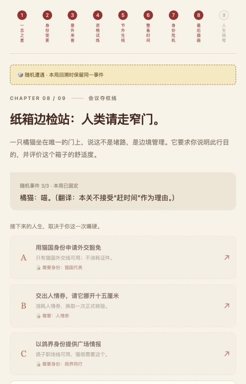

# 🍟 麦门人生模拟器

**你以为那只是老板的猫，结果猫是老板的老板。**

一个可以回溯的荒诞文字冒险：论文赶工人、下班逃跑家、周末漫游者，九次选择，把午饭过成另一种人生。

本地 3.1 快玩版：点“取号”随机开启人生，小票展示真实身份与启动资金，直接进入第一个选择。也可以自己选角色。普通行动点一下就发生；剧情中花钱或交出道具时先看说明、再确认。完整剧情和说明可以回看，喜欢分镜阅读也能随时切换。**本次更新尚未推送，以下在线链接仍为此前发布版本。**

**[▶ 直接开玩](https://zhouzixuan2333.github.io/maimen-life-simulator/) · [反馈剧情 / 提交想法](https://github.com/zhouzixuan2333/maimen-life-simulator/issues) · 喜欢就点个 Star ☆**

无需登录，无需安装，无需 Token。电脑、手机都可以玩。

## 能有多离谱？

- 回复导师“正在收尾”，下一秒被拉进国际研讨会主讲人群。
- 把“下班”写成唯一 KPI，最终成为“散会权终身持有人”。
- 跟着老板的猫走，发现老板在给它做会议记录。
- 取餐号是 404，你开始怀疑找不到的不是订单，是这个宇宙。

## 不止是点三个按钮

| 玩法 | 你的选择有什么后果 |
| --- | --- |
| 3 个角色、9 条路线 | 学术、悬案、时空、会议、AI 分身、创业、猫国、宇宙、鸽界 |
| 每局 9 次剧情选择 | 身份改变、资格试炼、补给、危机、终章都有独立回合 |
| 6 种随机遭遇，每局抽 3 种 | 临检、售后、打印机罢工、猫国边检、未来快递、合理性回访 |
| 身份与背包影响选项 | 管理者能批准打印机休假；拿不出原件就只能想别的办法 |
| 45 种人生 | 36 个普通结局 + 9 个需要前置条件的隐藏结局 |
| 可回溯、自动存档 | 改选会恢复物品和现金；刷新不会换掉本局随机遭遇 |

比如：拿原件换通行证 → 无法通过资格试炼 → 用管理者身份赚到人情券 → 花钱赎回原件 → 消耗人情券请人担保 → 解锁隐藏人生。

<details>
<summary>看看游戏画面</summary>



</details>

## 怎么运行

在线版直接点击顶部“开玩”。本地版不需要构建：

```sh
git clone https://github.com/zhouzixuan2333/maimen-life-simulator.git
cd maimen-life-simulator
python3 -m http.server 8765 --bind 127.0.0.1 --directory dist
```

打开 http://127.0.0.1:8765/ 。适合喜欢文字冒险、无厘头剧情、分支收集的玩家，也适合想研究无依赖游戏状态机和 Agent Skill 的开发者。

## MCP 现实支线（本机可选）

本项目包含官方活动日历的本地接入代码与 Agent Skill。连接后，在游戏上方展开“现实支线”，查看麦当劳当期活动，为这场离谱冒险安排一顿现实午饭。

```sh
python3 scripts/mcd_bridge.py
```

打开 http://127.0.0.1:8766/connect ，按页面引导在本机输入官方 Token。只查询活动日历，Token 不保存、不上传到公开网站。公开在线版保持无需 Token 的完整游戏。

**已完成官方 MCP 真实联调（2026-10-20）：活动日历查询成功。已提交[官方报名 #908](https://github.com/M-China/mcd-developer-innovation-challenge/issues/908)，当前等待官方确认；报名是否成功以该 Issue 的官方回复为准。** 详情见 [MCP_INTEGRATION.md](MCP_INTEGRATION.md)。使用 Agent 客户端时，可安装 [maimen-life-simulator Skill](skills/maimen-life-simulator/SKILL.md)。

## 开发与测试

- `dist/story.js`：主线与普通结局。
- `dist/events.js`：随机事件、资格试炼、隐藏结局。
- `dist/engine.js`：纯状态机、条件判定、物品消耗、存档重放。
- `dist/app.js` / `style.css`：界面与本机存档。
- `scripts/mcd_bridge.py`：仅在本机运行的官方活动日历桥接。
- [开发记录](docs/DEVELOPMENT.md)：九回合规则、验证与回退基准。

```sh
node tests/engine.test.cjs
python3 -m unittest discover -s tests -p 'test_*.py'
```

游戏测试覆盖全部 45 个结局和 6 类遭遇，并检查消费、锁定选项、精确回溯与存档恢复。MCP 测试使用模拟响应验证协议和错误处理；真实账号联调另有[脱敏验证记录](docs/MCP_VERIFICATION.json)。

## 一点说明

非麦当劳官方产品，无官方背书。所有游戏剧情、菜单、价格、身份和道具均为虚构。官方活动信息仅在明确连接成功后单独展示，以官方实时说明为准。没有真实下单、付款、领券、积分兑换或抽奖。

不收集玩家账号；游戏进度与档案仅存于当前浏览器。清除浏览器数据或更换设备后，存档不会自动迁移。

本项目代码与原创剧情使用 [MIT License](LICENSE)。商标及第三方服务不属于此授权范围。
